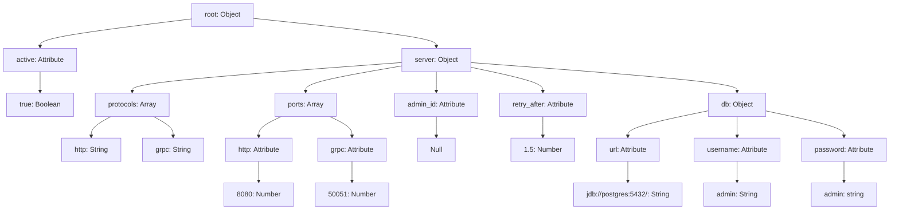

# Парсер

## 1. Лексер
Задача лексера - из одной строки создать последовательность токенов
для последующей их обработки.

Что должен делать лексер:
- Определять типы токенов
- Записывать значения соответствующих токенов внутрь них
- Добавить метаданные в токены для человекочитаемых ошибок и анализа
- Определять лексические ошибки (например, неверный формат числа: 1.23.24 (нельзя две точки в одном числе) или незакрытая кавычка в строке)

Чего лексер делать не должен:
- Думать о том, что после чего должно стоять. Лексер НЕ знает что было до, что будет после. Основная идея в том, чтобы: определил -> записал -> забыл -> переходим к следующему токену
- Определять ошибки, зависящие от других токенов (например, незакрытая скобка, неправильная табуляция, значение не в том месте). Важно заметить, что лексер может определить незакрытую кавычку, но не может определить незакрытую строку, потому что для лексера кавычка - это не отдельный токен, а указатель начала строки, сама кавычка в токены не записывается. Напротив, скобка - это самостоятельный токен, поэтому лексер не должен думать о его правильном положении

### Что нужно сделать на этом этапе
1. Продумать архитектуру токенов (см. `tokens.py`)
2. Реализовать функцию `tokenize()`
3. Проверить, что все типы правильно определяются, никакой токен не "съедает следующий"

### Как это должно выглядеть

Пусть дан YAML:
```yaml
field1: "str"
obj1:
  field2: 10
  field3: true
```

На выходе из `tokenize()` должно быть примерно следующее:
```python
[
  Identifier("field1"),
  Assign(),
  Space(),
  String("str"),
  LF(),
  Identifier("obj1"),
  Assign(),
  LF(),
  Tabs(1),
  Identifier("field2"),
  Assign(),
  Space(),
  Number("10"),
  LF(),
  Tabs(1),
  Identifier("field3"),
  Assign(),
  Space(),
  Boolean(true),
  LF(),
  EOF()
]
```

По поводу `Space()` я не уверен, лучше проверить спеку. Вроде бы после присваивания обязательно должен идти пробел, а только потом значение, но это нужно проверить. Токен `EOF` обозначает конец файла и, в целом, не обязателен.

## 2. Парсер

Самая интересная и трудная часть. Теперь, когда получили массив токенов, необходимо построить абстрактное синтаксическое дерево (AST).

### Что такое дерево?
Я надеюсь, что представлешь как выглядят деревья в программировании: дерево состоит из элементов (nodes), в которых хранятся их значения, а также ссылки на соседей (и/или родителей в зависимости от реализации).

Например, в java ноду двоичного дерева можно задать следующим образом:
```java
interface Node {
  public Object Value();
  public Node Left();
  public Node Right();  
}
```

В питоне для этой цели могут использоваться также как ссылочные типы (классы), так и словари
```python
class Node:
  def __init__(value):
    self.left = None
    self.right = None
    self.value = value
```

### Абстрактное синтаксическое дерево (AST)
AST - это такое дерево, которое будет хранить информацию о структуре твоего файла. Поскольку в YAML есть много разных типов данных, понадобится несколько типов Node, для хранения. Из них можно выделить основные:
- Object
- Array
- Attribute
- String
- Number
- Boolean
- Null

*возможно, есть другие, это я прикинул на первый взгляд*

#### Как это должно выглядеть?
Пусть у нас есть YAML:
```yaml
active: true
server:
  protocols:
    - http
    - grpc
  ports:
    - http: 8080
    - grpc: 50051
  admin_id: null
  retry_after: 1.5
  db:
    url: jdb://postgres:5432/
    username: "admin"
    password: "admin"
```

Из этого должно получится примерно такое дерево

*я устал писать это, надеюсь, оно хотя бы нормально отрендерится и это будет видно*

Выглядит сложно, а когда начнёшь писать, будет ещё сложнее. Но если это написать, то
1. Это круто, что ты смог построить дерево из файла, можно собой гордиться
2. Это дерево очень легко перевести в абсолютно любой формат (тебе нужен будет INI и XML)

Сейчас попробуй сам придумать архитектуру, продумай все типы. В целом, если у тебя будет строиться пример, то этого уже достаточно. Деревья можешь строить на классах (я так делал) или на мапах (я так тоже делал). Посмотри, как будет удобнее и понятнее

P.S. С днём рождения! 🎁

P.P.S. Тесты которые я закинул необзательно делать все. Конечно, если ты сможешь вообще всё реализовать, то это круто, но там где-то есть не осень приятные и понятные вещи, поэтому можно сделать основные вещи (почему у тебя не работают отричательные и дробные числа? это даже не е-нотация, которую, я был уверен, ты забудешь)
